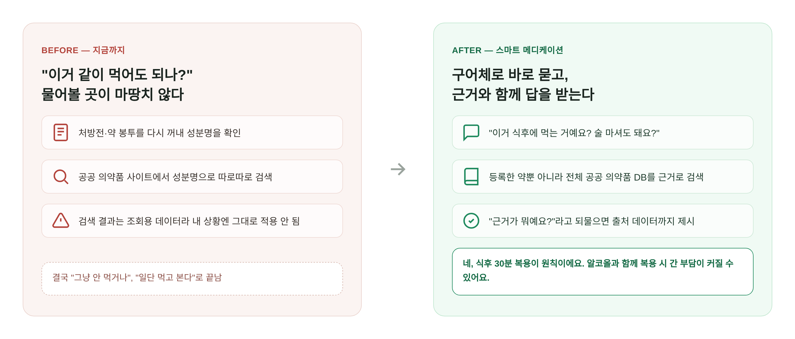
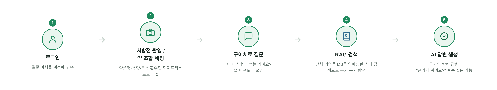

# 스마트 메디케이션 (Smart Medication) 기획서 v3

- 작성일: 2026.11.18
- 작성자: 강예빈
- 문서 성격: **포트폴리오용 프로젝트 기획서**
- 배포: [smart-medication.vercel.app](https://smart-medication.vercel.app) · 백엔드 Render(smart-medication-api.onrender.com)
- 저장소: github.com/kangyebyn-debug/smart-medication
- 성격: **비영리 개인 사이드 프로젝트** (수익화는 목표가 아님)

> 📎 이 문서는 표/다이어그램 중심으로 보기 좋게 구성한 버전이며, 실제 제출용 서식은 `01_기획서_v3.docx`에 맞춰져 있습니다(색상·레이아웃은 docx에서만 확인 가능). v2(`01_기획서_v2.md`)는 내부 실무 스펙 문서로 계속 보존합니다.

---

> **"이거 같이 먹어도 되나?"**
> 누구나 한 번쯤 묻지만, 바로 답해주는 곳은 마땅치 않습니다. 스마트 메디케이션은 이 흔한 질문 하나에서 시작된 개인 프로젝트입니다.

## 1. 기획 배경 — 왜 시작했는가

처방약과 일반의약품을 함께 먹을 때, 혹은 여러 약을 한 번에 처방받았을 때 "같이 먹어도 되는지", "언제 먹어야 하는지"가 궁금해지는 순간이 있습니다. 공공 데이터(식약처 DUR, e약은요)는 공개되어 있지만, 성분명 기반의 조회용 데이터라 비전문가가 구어체로 묻고 바로 답을 얻을 수 있는 형태는 아닙니다.

**상황 → 행동 → 목표**

- **상황**: 약학정보원(health.kr) 공식 페이지를 직접 확인한 결과, 의약품 검색·DUR 상호작용 조회 메뉴는 있지만 자연어 질문에 답하는 기능은 확인한 범위에서 찾지 못함
- **행동**: "약품 검색 / 병용금기 확인"만 제공하던 v1을, 공공 DUR 데이터를 RAG로 임베딩해 전체 의약품 데이터베이스를 대상으로 자연어 질의가 가능한 AI 탭 중심 구조로 재기획
- **목표**: 로그인 없이도 기본 기능은 바로 쓸 수 있고, 로그인하면 내 약 조합을 기준으로 AI에게 구어체로 물어볼 수 있는 서비스 완성 — 그리고 기획부터 배포까지 AI를 핸들링하며 전 과정을 혼자 완성할 수 있음을 증명 (**수익화는 목표 아님**)

## 2. 프로젝트 개요

| 항목 | 내용 |
|---|---|
| 서비스명 | 스마트 메디케이션 (Smart Medication) |
| 성격 | 개인 비영리 사이드 프로젝트 (수익화 목표 아님) |
| 최종 목표 | iOS·Android 모두 사용 가능한 크로스플랫폼 앱 (웹 우선 개발) |
| 현재 배포 | 프론트 Vercel(smart-medication.vercel.app) · 백엔드 Render(smart-medication-api.onrender.com) |
| 핵심 기술 목표 | AI(RAG·LLM) 핸들링 능력을 실제 서비스 완성으로 증명 |
| 핵심 데이터 소스 | 식약처 공공 DUR API, e약은요 공공 API, 식약처 의약품 제품 허가정보 API |

## 3. 타겟 사용자

불특정 다수를 위한 상용 서비스가 아닌 개인 프로젝트이므로, 아래 두 유형은 실제 사용자 인터뷰가 아니라 **기획 의도를 구체화하기 위해 설정한 가상 사용자상**입니다.

| 구분 | 설명 | 핵심 니즈 |
|---|---|---|
| 유형 A — 일반 소비자 | 처방약과 약국에서 산 일반의약품을 함께 복용하려는 사람 | 의료 지식 없이도 "같이 먹어도 되는지"를 바로 확인하고 싶음 |
| 유형 B — 다약제 복용자 | 여러 약을 한 번에 처방받아 복용법이 헷갈리는 사람 | 등록한 약 전체를 기준으로, 구어체로 질문하고 바로 답을 받고 싶음 |

## 4. 핵심 기능 (우선순위 — MoSCoW)

| 우선순위 | 기능 | 설명 |
|---|---|---|
| **Must** | 약품 검색 | 제품명으로 검색, 포장·전문/일반 구분 즉시 확인 (로그인 불필요) |
| **Must** | 병용금기 확인 | 두 약물 선택 시 함께 복용 가능 여부 확인 (로그인 불필요) |
| **Must** | 복약 질문 AI ★메인 기능 | 처방전 촬영/약 조합 세팅 후 구어체 질문 → RAG로 전체 의약품 DB에서 근거를 찾아 LLM이 답변 |
| **Should** | 나의 약 | 자주 먹는 약을 계정에 등록, 여러 기기에서 동기화 |
| **Should** | 약 상세정보 보강 | 복용 횟수, 식전/식후 여부 등 실제 복약 정보 보강 |
| **Could** | 음식-약물 상호작용 | 자몽·우유·알코올 등 음식과 약물의 상호작용 경고 |
| **Could** | 크로스플랫폼 전환 | 웹 기반 완성 후 iOS/Android 앱 전환 |
| **Won't (현 단계)** | 수익화 · HIRA 투약이력 연동 | 9장 "비범위" 참고 |

## 5. 기존 서비스 대비 차별점

경쟁 서비스를 전수 조사했다는 뜻은 아니며, 확인한 범위 내에서 정리한 비교입니다.

| 항목 | 공공·기존 서비스 (확인 범위) | 스마트 메디케이션 |
|---|---|---|
| 입력 방식 | 약품명·성분명 검색 (health.kr 등) | 구어체 자연어 질문 |
| 대상 범위 | 검색한 약 개별 조회 | 전체 공공 의약품 DB를 RAG로 임베딩해 등록하지 않은 약도 질의 가능 |
| 로그인 | 서비스별 상이 (미확인) | 약품 검색·병용금기 확인은 로그아웃 상태에서도 사용 가능 |

## 6. 기능 범위 — 로그인 여부 기준

| 기능 | 로그인 필요 여부 | 비고 |
|---|---|---|
| 약품 검색 | **불필요** | 로그아웃 상태에서도 항상 사용 가능해야 함 |
| 병용금기 확인 | **불필요** | 〃 |
| 나의 약 (저장) | 필요 | 계정 단위로 여러 기기에서 동기화 |
| 복약 질문 AI 탭 | 필요 | 질문 이력을 계정에 귀속 |
| 처방전 업로드 | 필요 | 민감정보 처리가 동반되므로 인증된 사용자만 |

## 7. 사용자 플로우 — 핵심 시나리오

**시나리오 2 — 복약 질문 AI (★메인 기능, 유형 B)**

**시나리오 1 — 로그인 없이 바로 확인 (유형 A)**
홈/랜딩 진입 → 검색창에 약 이름 입력 또는 "병용금기 확인" 카드 클릭 → 두 약 선택 → 결과 확인 (계정 불필요)

**시나리오 3 — 처방전 업로드 시 개인정보 처리**
처방전 사진 업로드 → 서버에서 약품명·용량·복용 횟수·복용 시점만 화이트리스트로 추출 → 원본 이미지·OCR 원문은 즉시 폐기, 추출된 구조화 데이터만 계정에 저장 (상세 설계는 `02_설계서_아키텍처_보안.md` 2-2절)

## 8. 기술 스택 및 선정 이유

| 영역 | 선택 | 선정 이유 |
|---|---|---|
| 프론트엔드 배포 | Vercel | 무료 티어로 정적/SSR 프론트엔드 배포 가능 |
| 백엔드 배포 | Render | 무료 티어로 FastAPI 백엔드 배포 가능 |
| 백엔드 | FastAPI | 공공 API 연동·RAG 파이프라인을 붙이기 위한 Python 백엔드 |
| 관계형 DB + 인증 | Supabase | 계정·나의 약·채팅이력처럼 용량이 작은 데이터에 적합. 무료 DB 500MB로 충분하고, **Auth가 기본 포함되어 암호화·세션 관리를 직접 구현할 필요가 없다는 점이 결정적**이었음 |
| 벡터 DB | Pinecone | 전체 의약품 데이터를 RAG 대상(범위 B)으로 삼으면서 예상 벡터 규모(추정 0.8~1.5GB)가 Supabase/Neon 무료 DB로는 버거워, 무료 Starter(저장 2GB·월 쓰기 200만 건)로 분리 |
| RAG 구조 | 임베딩 + 벡터 검색 + LLM | 전체 의약품 설명 텍스트를 임베딩해 벡터 검색 후, 근거를 LLM에 주입해 답변 생성 |

> DB를 Supabase·Pinecone 두 개로 분리한 이유와 구체적인 가격·용량 비교는 `03_DB_설계서.md`에 상세히 정리되어 있습니다.

## 9. 비범위 (Out of Scope, 현 단계)

- **수익화** — 이 프로젝트의 목표가 아님
- **건강보험심사평가원(HIRA) 투약이력 공식 연동** — 건강정보 고속도로(마이헬스웨이) 확인 결과 제공/활용 주체가 병·의원 등 **기관 단위**로 한정되는 것으로 보이며, 개인 등록 경로가 공개 페이지에 없어 **장기 과제로 보류**

## 10. 로드맵 개요

구체적인 일정(날짜)은 아직 확정하지 않았으며, 단계(Phase) 순서로만 정리합니다.

| Phase | 내용 |
|---|---|
| Phase 1 | 약 상세정보 보강 |
| Phase 1-1 (파생) | UI 리디자인 적용 — `04_UI_설계서.md`의 녹색 브랜드 컬러와 B안 사이드바 내비게이션을 Phase 2 이전에 반영. 2026.11.18 로컬 코드에는 검색 중심 랜딩, 앱 홈, 약품 검색·병용금기·나의 약 전용 화면이 적용됨. 배포 여부는 별도 확인 필요 |
| Phase 2 | 계정/DB 기반 전환 (Supabase Auth + 나의 약 동기화) |
| Phase 3 | 복약 질문 AI — 등록된 약 기준 (RAG 없이 프롬프트 직접 주입) |
| Phase 4 | 복약 질문 AI — 전체 의약품 대상 확장 (RAG, 벡터DB 도입) |
| Phase 5 | 처방전 OCR + 화이트리스트 추출 파이프라인 |
| Phase 6 | 음식-약물 상호작용 |
| Phase 7 | 크로스플랫폼(iOS/Android) 전환 |
| 장기 과제 | 심평원 투약이력 연동 (기관 등록 가능 여부 재확인 후 재검토) |

## 11. 근거 자료

- 기존 저장소 README (github.com/kangyebyn-debug/smart-medication)
- 2026.11.17 실제 배포 서비스(smart-medication.vercel.app) 접속·기능 테스트
- 건강정보 고속도로 공식 포털(myhealthway.go.kr) 개인/기관 안내 페이지 직접 확인
- Supabase, Neon, Render, Pinecone, Qdrant, MongoDB Atlas 공식 가격/문서 페이지 직접 확인 (2026.11.17 기준)
- 약학정보원(health.kr) 공식 페이지(회사소개, 픽토그램 복약정보) 직접 확인 (2026.11.18) — 의약품 검색·DUR 상호작용 메뉴 존재 확인, 자연어 질문 기능은 해당 페이지 범위에서 미확인
- 개발자 포트폴리오 기획서 작성법 관련: [합격하는 개발자 포트폴리오 작성 방법](https://www.elancer.co.kr/blog/view?seq=259), [프로젝트 절차 1단계](https://velog.io/@gaebalno/프로젝트-절차-1단계), [25번 면접 본 기획자의 이직 A to Z ② 포트폴리오와 면접](https://yozm.wishket.com/magazine/detail/2700) — 세 글을 참고해 기획 배경(상황-행동-목표), 타겟 사용자(페르소나), 핵심 기능 우선순위(MoSCoW), 사용자 플로우 섹션 구성과 다이어그램 활용에 반영함. "차별점"과 "기술스택 선정 이유" 항목의 표준 양식은 세 글에서 직접 확인되지 않아, 이 두 섹션의 구성 방식 자체는 작성자(AI)의 구조적 판단이며 특정 출처를 인용한 것은 아님.
