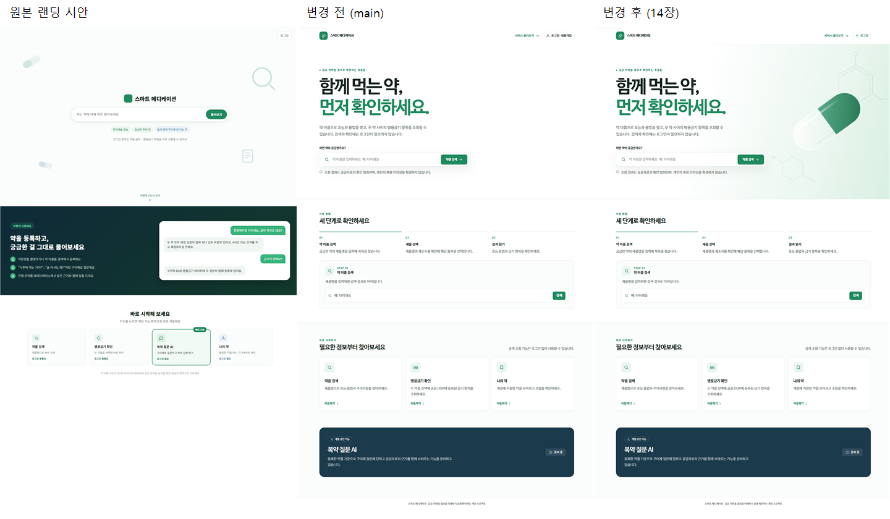
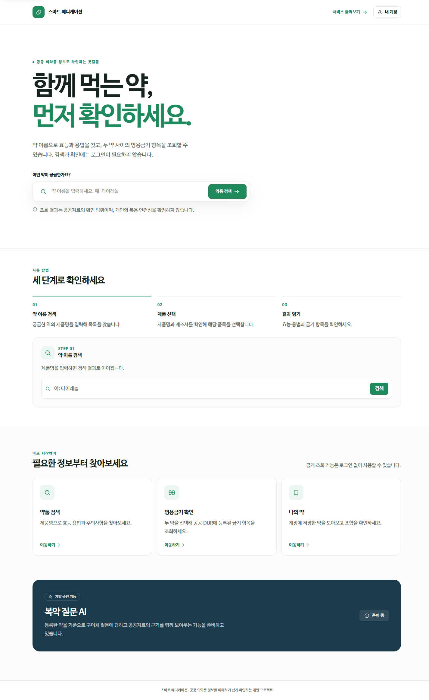
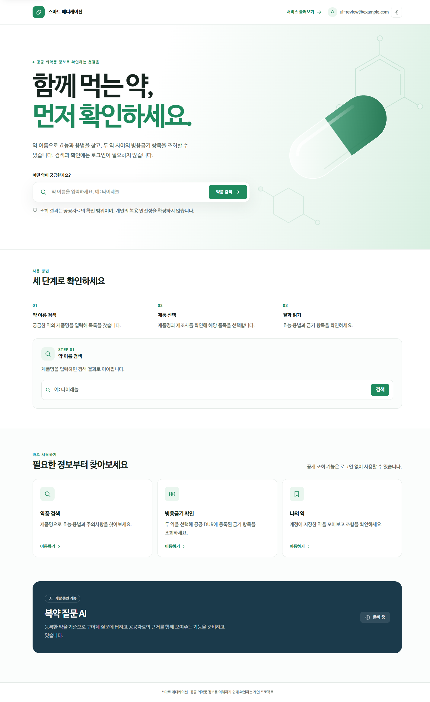
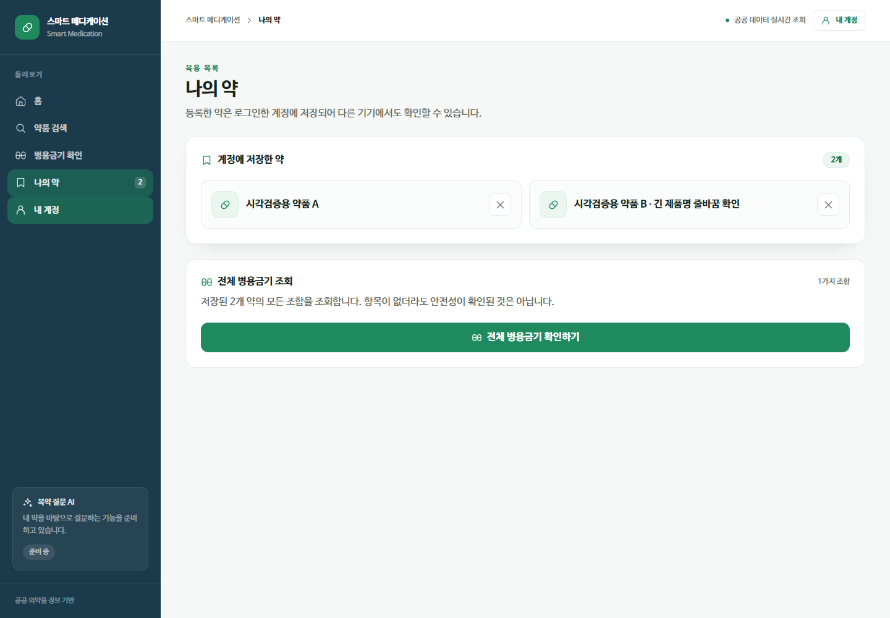
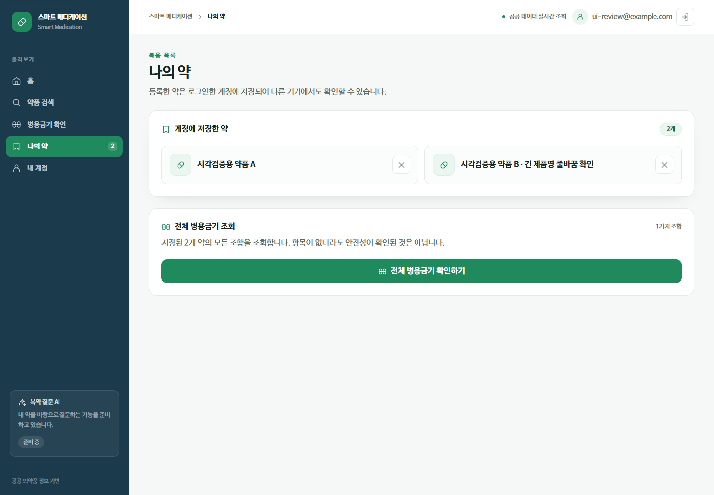
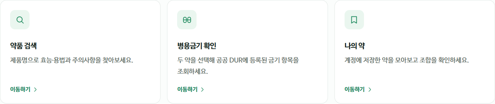
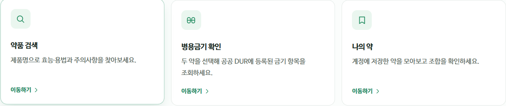

# Phase 3 진입 전 UI/UX 검토 및 적용 보고

검토일: 2026.11.23 (KST). 기준 코드: `main`의 `cc0ec28`. 작업 범위: `AGENTS.md` 14장.

## 1. 비교 방법과 근거

- [04_UI_설계서](04_UI_설계서.md)의 확정된 Landing/B안, 팔레트, 타이포그래피, 카드 규칙을 기준으로 삼았다.
- [원본 디자인 캔버스](https://claude.ai/artifact/9WaFU7u9ymXM7ZDTYTtTnY)를 브라우저에서 직접 열었다. [캔버스 캡처](assets/ui-review-2026-11-23/reference-canvas.png)를 보존하고, 캔버스 안의 Landing·DesignB·B-Detail iframe DOM을 각각 1440×1000 뷰포트에서 단독 렌더링해 전체 페이지를 캡처했다. 캔버스 축소율 18%를 앱 화면 크기로 오인하지 않도록 한 방법이다.
- 로컬 `http://localhost:5173`을 동일한 1440×1000 뷰포트, DPR 1에서 변경 전후 캡처했다. 아래 수치는 DOM의 실제 경계 상자와 문서 높이를 반올림한 CSS px다. 원본 시안은 고정 스크롤바 때문에 콘텐츠 폭이 1425px인 경우가 있으므로, 완전한 픽셀 일치 판정으로 쓰지 않는다.
- 랜딩·홈·검색 초기/결과/상세·병용금기·나의 약·로그인·회원가입을 실제 React 앱에서 렌더링했다. 전후 화면의 조건을 맞추기 위해 별도 브라우저 컨텍스트에서 Auth와 약품 API 응답을 모의 처리했다. 계정은 `ui-review@example.com`, 약품명은 `시각검증용 약품 A/B`다. 설명에도 실제 의약품/복약 정보가 아님을 표시했다. 실제 계정 생성·운영 DB 쓰기·실제 의료 결과 검증은 수행하지 않았다.
- [참고 포털](https://ai.minisoft.co.kr/)도 실제로 열어 배경 블렌딩·카드 elevation·분리된 사용자 영역을 확인했다. 해당 사이트의 로고·문구·일러스트 자산은 앱에 가져오지 않았다.
- 검색·병용금기·나의 약·인증은 원본 캔버스에 전용 화면이 없다(`04` 4-1절). 이들은 B안의 사이드바/본문 폭/카드 밀도와 비교했으며, 존재하지 않는 전용 시안과의 불일치라고 단정하지 않았다.
- 원본 시안의 AI 답변·복용 예시는 시각 비교 자료이며, 의료적 정답이나 구현 요구로 사용하지 않았다.

## 2. 비대해진 지점과 어색한 부분 목록

전체 랜딩은 시안 1744px, 변경 전 2321px로 약 33% 길어졌다. 다만 콘텐츠와 개발 단계가 달라 높이 차이 전부를 불필요한 여백으로 보지는 않는다. 아래의 **제안** 항목은 14장 4번에 따라 적용하지 않았다.

| 번호 | 위치와 캡처 근거 | 구체적인 관찰 | 이번 처리 / 후속 제안 |
|---|---|---|---|
| 1 | [시안 랜딩](assets/ui-review-2026-11-23/reference-landing.png) ↔ [변경 전 랜딩](assets/ui-review-2026-11-23/before-landing.png) | 시안은 중앙 검색창과 작은 서비스명 중심이다. 현재는 좌측 2행 제목이 86.4px이고 우측이 흰 공간이라 검색창보다 제목이 지배적으로 보인다. **히어로 자체는 시안 860px보다 현재 744px로 낮으므로, 높이 비대화로 판정하지 않는다.** | 배경 일러스트·그라데이션 적용. 제목 크기/정렬/히어로 패딩은 유지. 제목 강조 수준 재검토는 제안. |
| 2 | 같은 랜딩의 사용 방법 | 시안의 설명+미리보기 병렬 영역은 427px. 현재는 제목→3개 탭→232px 미리보기 카드가 세로로 쌓여 총 591px이며, 선택 단계의 제목이 탭과 미리보기에 반복된다. | 단계 선택 기능과 구조 유지. 탭과 미리보기의 병렬 배치 또는 중복 공간 축소를 제안. |
| 3 | 같은 랜딩의 기능 카드 | 시안은 4열, 카드 약 282×173px. 현재는 공개 기능 3열, 약 397×258px이며 48px 아이콘 뒤 28px 간격, 하단 이동 링크가 더해져 밀도가 낮다. 현재 `min-h-56`만으로 실제 높이 258px를 설명할 수는 없으며 콘텐츠·패딩이 함께 작용한다. | 카드 크기·개수·문구 유지. 두 카드 유형의 호버만 통일. 카드 내부 간격 축소는 제안. |
| 4 | [변경 전 홈](assets/ui-review-2026-11-23/before-home.png) ↔ [B안](assets/ui-review-2026-11-23/reference-app.png) | B안은 상단 검색 후 최근 약을 작게 보여준다. 현재 홈은 큰 소개 카드+행동 버튼 다음에 나의 약/안내 카드가 이어져 실제 검색 입력은 다음 화면에 있다. 진입 설명이 중복되는 인상이다. | 구조·동작 유지. 홈 소개 밀도와 검색 접근 배치는 별도 설계 제안. |
| 5 | [변경 전 상세](assets/ui-review-2026-11-23/before-detail.png) ↔ [B-Detail](assets/ui-review-2026-11-23/reference-detail.png) | 시안은 제품 요약·금기 배지·본문 탭으로 요약한다. 현재는 검색 카드→제품 카드→효능/용법 카드와 주의 카드로 중첩돼 정보 도달까지 세로 이동이 늘어난다. 안전성 안내와 출처 표시는 필요한 콘텐츠다. | 기능·안내·출처 유지. 중첩 카드 테두리와 요약 배치 정리를 제안. |
| 6 | [변경 전 병용금기](assets/ui-review-2026-11-23/before-compare.png), [모바일 결과](assets/ui-review-2026-11-23/after-long-email-app-320.png) | 외부 비교 카드→두 약품 입력 카드→선택 후 제품 카드의 중첩 구조다. 특히 좁은 화면에서 이미지·제품명이 세로로 쌓여 결과까지 거리가 길어진다. 전용 시안은 없다. | 기존 비교 기능 유지. 선택된 약 요약의 모바일 밀도 조정은 제안. |
| 7 | [변경 전 나의 약](assets/ui-review-2026-11-23/before-my-drugs.png) | 저장된 약 카드는 내부에서 다시 테두리로 감싸진 목록이다. 원본 전용 시안이 없어 크기 초과라고 단정할 수 없으나, 랜딩 카드에는 호버가 있고 이 카드에는 없어 피드백이 일관되지 않았다. | 저장 약 카드에 공통 호버/포커스 그림자 적용. 목록 그리드·패딩·삭제 동작 유지. |
| 8 | [변경 전 로그인](assets/ui-review-2026-11-23/before-signin.png), [회원가입](assets/ui-review-2026-11-23/before-signup.png) | 620px 중앙 폼과 좌우 빈 공간은 B안의 넓은 본문과 밀도 차이가 있지만 짧은 인증 작업에는 수용 가능하다. 헤더·사이드바·폼에서 인증 관련 진입이 반복된다. 전용 시안은 없다. | 헤더의 익명 버튼만 `로그인`으로 분리. 폼 내부 로그인/회원가입 전환과 사이드바 라벨은 유지. 폼 크기 변경은 제안 대상. |
| 9 | [변경 전 로그인된 랜딩](assets/ui-review-2026-11-23/before-landing-signed-in.png) 및 나의 약 헤더 | 로그인해도 헤더에는 `내 계정` 버튼 하나만 있어 계정 식별과 로그아웃 행동이 드러나지 않는다. 로그아웃하려면 계정 화면으로 이동해야 한다. | 두 헤더에 이메일·프로필 표시와 독립된 로그아웃 아이콘 적용. |

## 3. 실제 적용한 세 가지

| 요구 | 실제 변경 위치 | 결과 |
|---|---|---|
| 배경 일러스트 + 그라데이션 | `HeroIllustration.jsx`, `LandingPage.jsx`, `index.css` | 캡슐+분자 모티프를 인라인 SVG로 제작. 흰색에서 연녹색으로 이어지는 브랜드 그린 계열 배경에 혼합했다. 본문 위에 장식을 겹치지 않는 배치, 장식용 `aria-hidden`, 클릭을 가로채지 않는 `pointer-events: none`을 적용했다. 1100px 이하에서는 불투명도 0.18, 600px 이하에서는 0.1로 낮춘다. 기존 제목·폼·히어로 높이는 유지한다. |
| 카드 호버 | `LandingPage.jsx`, `MyDrugsPage.jsx`, `index.css` | 기존 랜딩의 4px 상승/약한 그림자를 공통 `elevated-card`로 바꾸고 저장 약 카드에도 적용. 정밀 포인터에서 180ms, 3px 상승, `0 12px 28px -8px` 녹색 그림자. 카드 내부 키보드 포커스에도 테두리/그림자를 제공하며 모션 감소에서는 이동을 제거한다. |
| 로그인 상태 영역 분리 | `HeaderAuth.jsx`, `App.jsx`, `LandingPage.jsx` | 두 헤더가 같은 컴포넌트를 사용. 익명은 단일 `로그인` 버튼, 로그인 후에는 이메일/프로필 표시+독립된 로그아웃 아이콘. 기존 `auth.signOut()`을 바로 호출하며 처리 중 중복 클릭 방지와 실패 안내를 제공한다. 긴 이메일은 말줄임하고 전체 값은 텍스트/툴팁에 남긴다. |

새 패키지를 추가하지 않았다. `frontend-design` 검토 절차는 기존 녹색 팔레트·나눔바른고딕·B안 구조를 유지하면서 의약품 모티프에만 시각적 강조를 집중하는 데 사용했다.

## 4. 스크린샷 나란히 비교

### 원본 / 변경 전 / 변경 후 랜딩

전체 이미지의 텍스트는 아래 원본 파일을 열어 확대할 수 있다.

| 원본 시안 | 변경 전 | 변경 후 |
|---|---|---|
| [Landing 전체](assets/ui-review-2026-11-23/reference-landing.png) | [랜딩 전체](assets/ui-review-2026-11-23/before-landing.png) | [랜딩 전체](assets/ui-review-2026-11-23/after-landing.png) |

### 계정 영역과 저장 약

| 대상 | 변경 전 | 변경 후 |
|---|---|---|
| 로그인된 랜딩 |  |  |
| 나의 약 |  |  |
| 카드 피드백 |  |  |

### 나머지 구현 화면

| 화면 | 원본 비교 기준 | 변경 전 | 변경 후 |
|---|---|---|---|
| 홈 | [DesignB](assets/ui-review-2026-11-23/reference-app.png) | [홈](assets/ui-review-2026-11-23/before-home.png) | [홈](assets/ui-review-2026-11-23/after-home.png) |
| 검색 초기 | B안 공통 구조 | [검색](assets/ui-review-2026-11-23/before-search.png) | [검색](assets/ui-review-2026-11-23/after-search.png) |
| 검색 결과 | B안 공통 구조 | [목록](assets/ui-review-2026-11-23/before-search-results.png) | [목록](assets/ui-review-2026-11-23/after-search-results.png) |
| 약품 상세 | [B-Detail](assets/ui-review-2026-11-23/reference-detail.png) | [상세](assets/ui-review-2026-11-23/before-detail.png) | [상세](assets/ui-review-2026-11-23/after-detail.png) |
| 병용금기 | B안 공통 구조 | [비교](assets/ui-review-2026-11-23/before-compare.png) | [비교](assets/ui-review-2026-11-23/after-compare.png) |
| 로그인 | B안 공통 구조 | [로그인](assets/ui-review-2026-11-23/before-signin.png) | [로그인](assets/ui-review-2026-11-23/after-signin.png) |
| 회원가입 | B안 공통 구조 | [회원가입](assets/ui-review-2026-11-23/before-signup.png) | [회원가입](assets/ui-review-2026-11-23/after-signup.png) |

각 화면의 본문 구조·문구는 유지하고 공통 헤더만 달라졌음을 확인할 수 있다. 이전 캡처 일부의 메뉴 색은 포인터 위치/기존 색상 전환 중 상태를 포함하며, 메뉴 동작 변경의 근거로 사용하지 않았다.

## 5. 검증 결과와 한계

- 각 코드 단위에서 프론트 `npm run lint`, `npm run build` 통과. 최종 diff도 별도 에이전트가 검토했다.
- 모의 응답 기반 브라우저에서 검색 결과→상세, 로그인/회원가입 모드 전환, 저장 약 목록/삭제/빈 상태, 두 약 선택→병용금기 결과를 확인했다. [빈 목록](assets/ui-review-2026-11-23/after-my-drugs-empty.png), [병용금기 결과](assets/ui-review-2026-11-23/after-compare-result.png). 결과의 안전성 유보 문구도 유지된다.
- 양쪽 헤더 로그아웃 성공 확인. 랜딩에서는 화면을 유지하고 로그인 버튼으로 바뀌며, 나의 약에서는 기존 인증 안내가 표시된다. [랜딩 로그아웃](assets/ui-review-2026-11-23/after-logout-landing.png), [나의 약 로그아웃](assets/ui-review-2026-11-23/after-logout-my-drugs.png).
- 로그아웃 요청 지연 중 아이콘 버튼이 비활성화되고, 400 응답 시 세션 표시와 오류 안내를 유지한다. 실패 1회+재시도 성공 1회+랜딩 성공 1회에 요청 3회를 관찰했다. [실패 안내](assets/ui-review-2026-11-23/after-logout-error.png).
- 랜딩/저장 약 카드 모두 기본 `transform: none`에서 호버 시 `matrix(1, 0, 0, 1, 0, -3)`로 바뀌고 같은 그림자를 갖는다. 모션 감소 설정은 `transform: none`으로 확인했다. 키보드 입력 후 로그아웃 버튼의 포커스 표시는 3px solid다.
- 기본 캡처 조건에서 320px·390px의 랜딩/홈/검색/병용금기/나의 약/로그인/회원가입 모두 문서 가로 넘침이 없었다. [랜딩 320](assets/ui-review-2026-11-23/after-landing-320.png), [나의 약 320](assets/ui-review-2026-11-23/after-my-drugs-320.png), [로그인 390](assets/ui-review-2026-11-23/after-signin-390.png). 나눔바른고딕 일반체/굵은체 로딩과 일련의 화면 캡처 중 JavaScript 오류 0건을 확인했다.
- 긴 이메일로 320/390/900/1024/1100/1101/1440px를 추가 확인했다. 이메일은 말줄임되며 로그아웃 버튼에 접근할 수 있다. [앱 헤더 320](assets/ui-review-2026-11-23/after-long-email-app-320.png), [랜딩 헤더 320](assets/ui-review-2026-11-23/after-long-email-landing-320.png), [1100px](assets/ui-review-2026-11-23/after-long-email-landing-1100.png), [1101px](assets/ui-review-2026-11-23/after-long-email-landing-1101.png).
- 이 스트레스 검증에서 고정 스크롤바가 표시된 320px 환경은 가용 폭 305px에 기존 `body { min-width: 320px }`가 걸려 문서가 15px 넘친다. 헤더 요소는 body 밖으로 나오지 않는다. 이는 기존 최소 폭 규칙과 스크롤바 조합의 문제로 기록하고 이번 범위에서 수정하지 않았다. 390px 이상은 해당 문서 넘침이 없었다.
- 실제 Supabase 로그인/로그아웃 서버와 실제 `/me/drugs` CRUD를 끝까지 잇는 테스트는 이번에 하지 않았다. 모의 계정의 SDK/화면 반응 검증과 구분해야 한다. 백엔드·API·Auth/MyDrugs 훅은 이번 변경에 포함되지 않는다.

## 6. 로컬 변경 단위

7-1/7-1-2/7-1-3 원칙에 따라 동작 가능한 시점마다 스택 브랜치를 남겼다.

| 브랜치 | 커밋 | 단위 |
|---|---|---|
| `feat/ui-hero-illustration` | `54e0fa4` | 캡슐·분자 배경 |
| `feat/ui-card-hover` | `c552af5` | 공통 카드 호버 |
| `feat/ui-auth-header` | `96b6dd7` | 헤더 로그인 상태 분리 |
| `docs/ui-ch14-review` | 별도 문서 커밋 | 이 보고서와 캡처 근거 |

원격 push/PR 생성은 수행하지 않았다. `AGENTS.md`, 환경변수, 기존 기능/API 계약은 변경하지 않았다. 2절의 추가 밀도·레이아웃 개선안은 후속 승인 대상으로 남는다.
