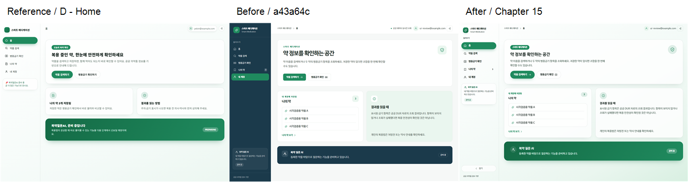
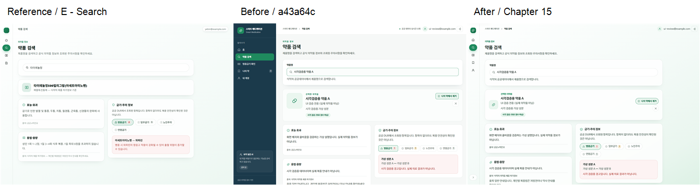
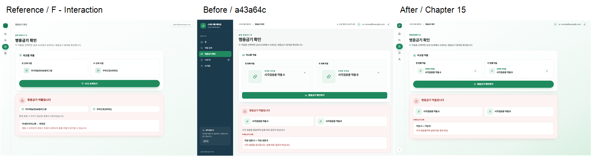
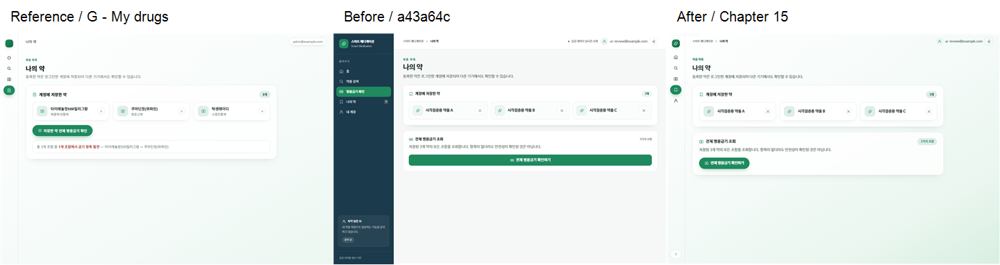

# 내부 화면 D/E/F/G 적용 보고 (2026-11-24)

## 1. 결과와 작업 범위

로컬 `design-reference/`의 D/E/F/G HTML·PNG를 기준으로 내부 홈, 약품 검색, 병용금기 확인, 나의 약 화면의 시각 스타일을 적용했다. HTML의 색상·간격·반경을 읽고 브라우저 computed style로 대조했으며, 스크린샷을 눈대중으로 복제하지 않았다.

이번 변경은 공통 셸의 배경·메뉴·접기 기능과 화면별 스타일에 한정한다. 검색 디바운스, API 호출, 저장/제거, 일괄 조회, 오류 처리, 기존 안내 문구와 제한은 유지했다. `frontend-design` 지침은 승인된 시안의 일관성, CSS 우선순위 점검, 화면 캡처 검증에 사용했으며 새로운 디자인 방향이나 패키지를 추가하지 않았다.

16장 계정 개편은 착수하지 않았다. `AuthPage.jsx`, `HeaderAuth.jsx`, `HeroIllustration.jsx`, `LandingPage.jsx`, hooks/API/경고 상수/백엔드/패키지는 수정하지 않았다. `Icon.jsx`의 compare 아이콘만 15장에 지정된 SVG로 교체했다.

## 2. 비교 자료

기준 커밋은 `a43a64c`이다. 전·후 앱은 1440×1000 viewport와 UI 검증 전용 가상 약품 A/B/C를 사용했다. 시안은 원본 HTML을 같은 viewport에서 열어 전체 1760px 아트보드를 캡처했다. 1440×1760은 참고 자료의 아트보드 크기이며 앱을 고정 크기로 만들지 않았다. 스크롤바와 페이지 길이에 따라 PNG의 실제 픽셀 폭·높이는 다를 수 있다.

아래 합성 비교는 왼쪽부터 **시안 / 변경 전 / 변경 후**이며, 각 원본의 상단 1000px 영역을 축소한 것이다. 의약품 데이터와 문구의 차이를 시각적 불일치로 판단하지 않았으며 원본도 함께 제공한다.

| 화면 | 한눈에 비교 | 시안 원본 캡처 | 변경 전 | 변경 후 |
|---|---|---|---|---|
| D · 홈/공통 셸 | [비교 D](assets/ui-ch15-2026-11-24/comparison-D.png) | [D](assets/ui-ch15-2026-11-24/reference-D_confirmed.png) | [전](assets/ui-ch15-2026-11-24/before-home.png) | [후](assets/ui-ch15-2026-11-24/after-home.png) |
| E · 약품 상세 | [비교 E](assets/ui-ch15-2026-11-24/comparison-E.png) | [E](assets/ui-ch15-2026-11-24/reference-E_search.png) | [전](assets/ui-ch15-2026-11-24/before-search-detail.png) | [후](assets/ui-ch15-2026-11-24/after-search-detail.png) |
| F · 병용금기 결과 | [비교 F](assets/ui-ch15-2026-11-24/comparison-F.png) | [F](assets/ui-ch15-2026-11-24/reference-F_interaction.png) | [전](assets/ui-ch15-2026-11-24/before-interaction-result.png) | [후](assets/ui-ch15-2026-11-24/after-interaction-result.png) |
| G · 나의 약 | [비교 G](assets/ui-ch15-2026-11-24/comparison-G.png) | [G](assets/ui-ch15-2026-11-24/reference-G_mydrugs.png) | [전](assets/ui-ch15-2026-11-24/before-my-drugs.png) | [후 · 접힘](assets/ui-ch15-2026-11-24/after-my-drugs.png) |

## 3. 확인한 문제와 실제 적용 지점

| 변경 전 확인 지점 | 실제 변경 | 근거/보존 사항 |
|---|---|---|
| 남색 사이드바·흰 헤더·회색 본문이 색 블록으로 분리됨 | `App.jsx`의 별도 배경을 제거하고 `.app-layout` 한 곳에서 대각선 그라데이션 적용. 사이드바는 투명+우측 경계선 | D 비교에서 세 영역이 한 배경으로 이어짐 |
| 사이드바 폭이 항상 260px이고 접을 수 없음 | React 로컬 state로 252px↔78px 접기/펼치기. 접힘 시 라벨·AI 안내·하단 안내 숨김 | G 접힘/펼침 캡처와 computed width 대조. 저장소나 서버에 상태를 기록하지 않음 |
| 메뉴와 주요 버튼의 반경이 제각각 | 사이드바·주요 행동·검색창·경고 탭·저장 칩을 pill로 통일. 주요 녹색 행동에 글로우 | 기존 경고 의미 색상과 버튼 동작은 보존 |
| 불투명 흰 카드와 남색 AI 배너로 내부 스타일이 분리됨 | 반투명 흰 카드·blur(3px), D의 녹색 배너 적용 | Home은 white .78, E/F/G 기본 카드는 white .82 |
| 홈 제목이 데스크톱 36px, 별도 민트 안내 카드와 큰 간격 | D 기준 제목 26px, hero radius24/padding34×38, overview radius20/padding26/gap24 | 기존 저장 목록과 전체 안전 안내는 삭제하지 않음 |
| 상세/비교 카드의 96px 이미지가 선택 영역에서 큰 비중을 차지 | 검색 상세 56px, F 선택 카드 42px. F 내부 카드 radius14/padding12×14 | DrugImage 자체의 공유 크기 API는 변경하지 않고 문맥별 CSS로 제한 |
| E/F/G 바깥 카드와 제목/eyebrow 체계가 서로 다름 | 바깥 카드 radius22, 데스크톱 padding26×28, 페이지 간격22. 제목27px·eyebrow12.5px | 나눔바른고딕과 기존 본문/안전 설명 16px 이상 유지 |
| 한글 라벨에 영문용 넓은 자간 사용 | App의 둘러보기, Home/선택 카드 및 E/F/G eyebrow의 넓은 tracking 제거 | 해당 라벨 computed letter-spacing: normal |
| 헤더의 실시간 조회 배지와 눈알처럼 보이는 compare 아이콘 | 배지 블록 제거. 캡슐 내부 선 없이 중앙 `M11 12h2`만 있는 지정 SVG 적용 | 계정 영역은 재작업하지 않음 |
| G의 목록·삭제 버튼이 기존 각진 스타일 | 목록 radius18/padding16×18/gap14, 아이콘46/radius14, 삭제 버튼32px 원형 | 기존 카드 호버·개별 삭제·일괄 조회 분기 보존 |

### HTML 기준값과 브라우저 실측

- 공통 배경: `linear-gradient(150deg, #FFFFFF 0%, #F3FAF7 50%, #EAF6EF 78%, #D8EFE1 100%)` — computed RGB 값과 일치.
- 선: `rgba(23,64,45,.13)`, 보조 글자: `#546A5F`. 앱 셸 안에만 변수 적용.
- 사이드바 펼침/접힘: **252 / 78px**. 헤더 기본 최소 높이 **68px**. 데스크톱 콘텐츠 여백 상단36/좌우32/하단60px, E/F/G 최대폭1150px.
- Home hero: 흰색 alpha **.78**, blur **3px**, radius **24px**, padding **34px 38px**.
- E 효능/용법/주의 패널: 흰색 alpha **.82**, blur **3px**, radius **20px**, padding **24px 26px**.
- E 상세 썸네일 **56×56px**, F 선택 썸네일 **42×42px**, F 선택 텍스트 min-width **0px**.
- E/F/G 제목 **27px**, eyebrow **12.5px / normal**, 실제 `NanumBarunGothic` 폰트 로딩 확인.
- 기존 경고 카드 배경: 병용 `rgb(253,243,243)`, 임부 `rgb(253,248,238)`, 연령 `rgb(246,248,247)` 확인. 노인주의는 가상 응답이 빈 목록이어서 항목 없음 안내를 확인했고, amber 매핑은 변경 없이 보존했다.

### 픽셀 단위 복제가 아닌 의도적 보존

시안의 예시 약명·용량·복용 안내·안전성을 암시하는 문구는 제품에 복사하지 않았다. 기존 실제 응답과 안내 문구를 계속 렌더링한다. 따라서 다음 차이는 유지된다.

- 홈에는 기존 3개 약 미리보기와 전체 안전 안내가 있어 시안의 짧은 요약 카드보다 높다.
- E에는 기존 검색 라벨/설명, 제조사·성분·분류·저장 버튼이 있어 시안보다 상세 카드가 높다.
- F에는 기존 선택 해제 버튼과 상세 제목을 유지했다. 결과 썸네일은 기존 DrugImage sm 크기를 보존했다.
- G는 기존 독립된 일괄 조회 카드와 금기/항목 없음/조회 실패 상세 분기를 유지했다. 정적 시안처럼 목록 카드 안에 결과를 합치지 않았다.
- 900px 이하의 기존 가로 스크롤 메뉴 규칙은 원문 그대로 보존했다. 고정 아트보드가 아니라 기존 반응형 흐름에 시안 토큰을 적용했다.

## 4. 검증 결과

### 코드/범위 검증

- `frontend`에서 `npm run lint`, `npm run build` 성공. 최종 빌드 79개 모듈.
- `git diff --check a43a64c -- frontend` 통과.
- 별도 에이전트가 7개 페이지/공유 컴포넌트의 AST에서 시각 속성(`className`, `style`, 아이콘 `size`)을 제외한 로직·문구·비시각 JSX가 기준 커밋과 같음을 확인했다.
- 보호 소스, hooks/API, 경고 상수, 백엔드, 패키지에 diff 없음. 기존 max-width900 미디어쿼리도 동일.
- 작업 전부터 변경돼 있던 사용자 `.gitignore`와 `docs/04_UI_설계서.md`는 수정/스테이징하지 않았고 SHA256 일치를 확인했다. 사용자 문서의 기존 EOF 공백은 수정하지 않았다.
- 새 패키지·스키마·환경변수·인증 방식 변경 없음. `AGENTS.md`, 환경파일, `design-reference/` 원본은 커밋하지 않음.

### 브라우저 동작 검증

| 항목 | 확인 결과 |
|---|---|
| 사이드바 | 마우스 및 Enter/Space로 접기/펼치기, aria-expanded 전환, 접힘 상태 메뉴 이동, 라벨 숨김 확인 |
| 모바일 전환 | 1440 접힘→390 직접 전환과 900↔901 경계 확인. 900 이하 가로 메뉴/라벨 표시, 접기 토글 숨김 유지 |
| 검색→상세 | 검색 결과 선택, 이미지/경고 요청에 `ITEM_SEQ` 전달, 효능/용법/주의 패널 표시 |
| 경고 탭 | 4개 탭 aria-pressed 전환, red/amber/neutral 경고 카드, 노인주의 항목 없음 문구 확인 |
| 저장/제거 | 검색 상세에서 제거→추가 왕복, DELETE/POST 요청, 목록 개별 삭제 후 빈 상태 도달 |
| 두 약 비교 | 저장 약 선택, 금기 결과, 항목 없음 결과의 안전성 한정 문구, 502 오류 안내 확인 |
| 일괄 조회 | 약 3개→3가지 조합. 금기1/항목 없음1/실패1을 섞어 일부 미확인 요약과 상세 모두 확인 |
| 호버/접근성 | 기존 카드 translateY(-3px)·그림자 유지, reduced-motion에서 transform:none, 키보드 접기 토글 확인 |
| 계정 UI 회귀 | 모의 로그인/로그아웃, 로그인↔회원가입 모드 전환 확인. 보호 컴포넌트는 수정하지 않음 |
| 실행 오류 | pageerror 수집 0건. 의도적으로 주입한 502에 따른 네트워크 콘솔 오류는 테스트 예상 결과 |

검증 중 발견한 두 CSS 충돌도 수정했다. 첫째, Tailwind utility가 컴포넌트 layer보다 우선해 썸네일이 96px로 남는 문제는 해당 상세 카드 안의 문맥 규칙만 layer 밖에 두어 해결했다. 둘째, 새 flex-basis 애니메이션이 모바일 100% 폭 전환에 간섭하지 않도록 애니메이션을 901px 이상으로 한정했다. 기존 모바일 규칙과 기능 로직은 수정하지 않았다.

### 추가 캡처

- 상태: [검색 목록](assets/ui-ch15-2026-11-24/after-search.png), [비교 선택 전](assets/ui-ch15-2026-11-24/after-interaction.png), [비교 항목 없음](assets/ui-ch15-2026-11-24/after-interaction-no-items.png), [일괄 혼합 결과](assets/ui-ch15-2026-11-24/after-bulk-mixed.png), [저장 목록 빈 상태](assets/ui-ch15-2026-11-24/after-my-drugs-empty.png), [나의 약 펼침](assets/ui-ch15-2026-11-24/after-my-drugs-expanded.png).
- 경고: [병용](assets/ui-ch15-2026-11-24/after-warning-병용금기.png), [임부](assets/ui-ch15-2026-11-24/after-warning-임부금기.png), [노인](assets/ui-ch15-2026-11-24/after-warning-노인주의.png), [연령](assets/ui-ch15-2026-11-24/after-warning-연령금기.png).
- 390px: [홈](assets/ui-ch15-2026-11-24/after-mobile-home.png), [검색 상세](assets/ui-ch15-2026-11-24/after-mobile-search.png), [비교 결과](assets/ui-ch15-2026-11-24/after-mobile-interaction.png), [나의 약](assets/ui-ch15-2026-11-24/after-mobile-my-drugs.png).

### 검증 한계와 기존 현상

화면 검증은 Playwright의 모의 Auth/API와 `ui-review@example.com` 가상 계정으로 진행했다. 캡처의 가상 약품/성분은 실제 의약품이나 의료 결과가 아니다. 운영 Supabase/공공 API/실제 계정으로 end-to-end 성공을 검증했다는 뜻은 아니며, 운영 데이터는 쓰거나 지우지 않았다. 배포·다른 브라우저 엔진의 검증은 하지 않았다.

390px에서 홈/검색/비교/나의 약의 문서 가로 초과는 없었다. 320px에서는 Windows의 15px 고전 스크롤바와 기존 `body { min-width:320px }` 조합으로 `clientWidth305 / scrollWidth320`이 나온다. 격리된 `a43a64c` worktree를 별도 포트로 실행해 동일하게 재현했다(390px는 기준/현재 모두 client375/scroll375). 이번 범위 밖의 기존 최소폭을 임의로 바꾸지 않았다. 기준 검증용 임시 서버·worktree·node_modules junction은 검증 후 정리했다.

## 5. 로컬 커밋과 인계

스택형 브랜치를 분리했고 push/PR/배포는 하지 않았다.

| 순서 | 브랜치 | 커밋/단위 |
|---|---|---|
| 1 | `feat/ui-d-shell` | `76d2d63` · D 공통 배경/데스크톱 접기/지정 아이콘 |
| 2 | `feat/ui-efg-pages` | `fdb753d` · 내부 홈/E/F/G 시각 스타일, 상세 카드 크기와 전환 검증 반영 |
| 3 | `docs/ui-ch15-review` | 이 보고서와 시안/전후/상태 캡처만 별도 문서 커밋 |

사용자 변경 2개 파일은 커밋에 포함하지 않고 작업 트리에 남겼다. `design-reference/`도 삭제하지 않고 로컬 참고 자료로 보존했다. 다음 단계는 사용자·검토자의 15장 화면 리뷰이며, 16장 작업이나 원격 반영은 별도 지시 후 진행한다.
